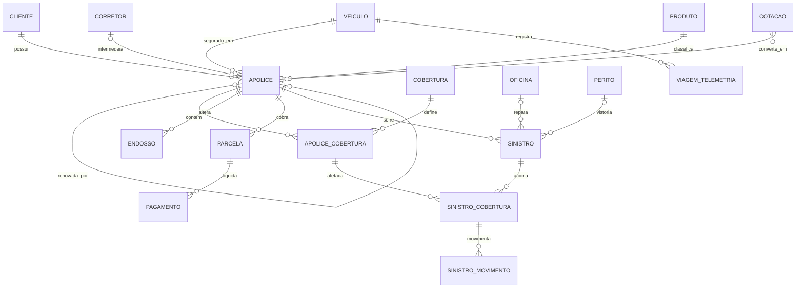

# Insurance Lakehouse: Dicionário de Entidades (Seguro Auto)

> **Status:** rascunho v0.1 (Fase 0: escopo de negócio e dicionário de dados)
> **Plataforma:** Databricks + Unity Catalog (catálogo `insurance`; schemas `raw`, `bronze`, `silver`, `gold`)
> **Uso:** base para os geradores de dados sintéticos, os contratos de qualidade da silver e o modelo dimensional da gold.

---

## Sumário

0. [Convenções e simplificações](#0-convenções-e-simplificações)
1. [Sistemas de origem](#1-sistemas-de-origem)
2. [Entidades transacionais e de eventos](#2-entidades-transacionais-e-de-eventos)
3. [Dados de referência](#3-dados-de-referência)
4. [Mapa de relacionamentos](#4-mapa-de-relacionamentos)
5. [Diagrama ER (Mermaid)](#5-diagrama-er-mermaid)
6. [Imperfeições a injetar](#6-imperfeições-a-injetar-qualidade-de-dados)
7. [Modelo dimensional da gold](#7-modelo-dimensional-da-gold-proposta)
8. [Métricas (fonte única da verdade)](#8-métricas-fonte-única-da-verdade)
9. [Perguntas de negócio](#9-perguntas-de-negócio)
10. [Governança: classificação de dados](#10-governança-classificação-de-dados-pii)
11. [Decisões pendentes](#11-decisões-pendentes)

---

## 0. Convenções e simplificações

| Sigla | Significado |
|---|---|
| **PK** | Chave primária |
| **FK** | Chave estrangeira |
| **NK** | Chave natural (do negócio) |
| **PII** | Dado pessoal (LGPD). Candidato a tag `pii=true` e a *column mask* |

- No Unity Catalog, **PK e FK são informativas e não são impostas** pelo motor. A integridade é garantida por testes de qualidade e *expectations*. `NOT NULL` e `CHECK` são impostas.
- **Chaves substitutas (surrogate)** só aparecem na silver (histórico/SCD) e na gold. Na origem usamos os IDs do sistema.
- Toda entidade OLTP chega ao `landing` com as colunas de controle `op_type` (`I`/`U`/`D`) e `updated_at`, que simulam **CDC** (Change Data Capture).
- **Nomenclatura:** minúsculas, sem acento, `snake_case`.

**Simplificações assumidas na v1**

- Segurado = condutor principal.
- Apenas pessoa física.
- Um veículo por apólice.
- Moeda única (BRL).

---

## 1. Sistemas de origem

| Sistema | Natureza | Formato no landing | Entidades |
|---|---|---|---|
| `policy_admin` | OLTP (CDC simulado) | Parquet/CSV incremental | cliente, corretor, veiculo, produto, cobertura, apolice, apolice_cobertura, endosso |
| `billing` | OLTP (CDC simulado) | Parquet/CSV incremental | parcela, pagamento |
| `claims` | OLTP (CDC simulado) | Parquet/CSV incremental | sinistro, sinistro_cobertura, sinistro_movimento |
| `partners` | Arquivos de parceiros | CSV com problemas de qualidade | oficina, perito |
| `web_quote` | Eventos de alto volume | JSON | cotacao |
| `telematics` | Eventos de alto volume | JSON | viagem_telemetria |
| `reference` | Dados públicos | CSV/XLSX | ref_municipio_ibge, ref_fipe, ref_susep_benchmark |

**Convenção de caminho no volume `landing`:**

```
/Volumes/insurance/raw/landing/<sistema_origem>/<entidade>/ingestion_date=AAAA-MM-DD/
```

---

## 2. Entidades transacionais e de eventos

### 2.1 `cliente` (policy_admin)

| Atributo | Tipo | Chave | Observação |
|---|---|---|---|
| id_cliente | STRING | PK | |
| cpf | STRING | NK | **PII.** Validar dígito verificador |
| nome | STRING | | **PII** |
| data_nascimento | DATE | | **PII.** Base da faixa etária (fator de risco) |
| sexo | STRING | | Domínio: M / F / Outro / NI |
| estado_civil | STRING | | |
| email | STRING | | **PII** |
| telefone | STRING | | **PII** |
| cep | STRING | | **PII** |
| cod_municipio_ibge | STRING | FK → ref_municipio_ibge | |
| data_cadastro | DATE | | |
| updated_at | TIMESTAMP | | Controle de CDC |
| op_type | STRING | | `I`/`U`/`D` |

### 2.2 `corretor` (policy_admin)

| Atributo | Tipo | Chave | Observação |
|---|---|---|---|
| id_corretor | STRING | PK | |
| cod_susep_corretor | STRING | NK | |
| nome_corretor | STRING | | |
| tipo | STRING | | Autônomo, corretora, canal digital |
| cod_municipio_ibge | STRING | FK | |
| status | STRING | | Ativo / Inativo |
| data_credenciamento | DATE | | |

### 2.3 `veiculo` (policy_admin)

| Atributo | Tipo | Chave | Observação |
|---|---|---|---|
| id_veiculo | STRING | PK | |
| chassi | STRING | NK | Único (17 caracteres) |
| placa | STRING | | Dado pessoal indireto: tratar com cautela |
| marca, modelo, versao | STRING | | |
| ano_fabricacao, ano_modelo | INT | | |
| cod_fipe | STRING | FK → ref_fipe | |
| categoria | STRING | | Hatch, sedan, SUV, utilitário, moto |
| combustivel | STRING | | |
| possui_rastreador | BOOLEAN | | Fator de risco (roubo) |
| updated_at, op_type | | | Controle de CDC |

### 2.4 `produto` e `cobertura` (catálogos, policy_admin)

**produto**

| Atributo | Tipo | Chave | Observação |
|---|---|---|---|
| id_produto | STRING | PK | |
| nome_produto | STRING | | |
| cod_ramo_susep | STRING | | **Validar na tabela de ramos da SUSEP** |
| segmento | STRING | | Básico, intermediário, premium |
| ativo | BOOLEAN | | |

**cobertura**

| Atributo | Tipo | Chave | Observação |
|---|---|---|---|
| id_cobertura | STRING | PK | |
| nome_cobertura | STRING | | |
| grupo_cobertura | STRING | | |
| obrigatoria | BOOLEAN | | |

Coberturas de partida: Compreensiva (colisão, incêndio, roubo/furto), RCF-DM (danos materiais a terceiros), RCF-DC (danos corporais), APP (acidentes pessoais de passageiros), Vidros, Assistência 24h, Carro reserva.

> **Atenção:** os códigos de ramo SUSEP para automóvel (0531 casco e 0553 RCF) foram citados de memória. Confirmar na tabela oficial de ramos antes de fixar no projeto.

### 2.5 `apolice` (policy_admin): entidade central

| Atributo | Tipo | Chave | Observação |
|---|---|---|---|
| id_apolice | STRING | PK | |
| numero_apolice | STRING | NK | |
| id_cliente | STRING | FK → cliente | |
| id_veiculo | STRING | FK → veiculo | |
| id_produto | STRING | FK → produto | |
| id_corretor | STRING | FK → corretor | Nulo = venda direta |
| id_apolice_anterior | STRING | FK → apolice (auto-relacionamento) | **Define a cadeia de renovação** |
| data_emissao | DATE | | |
| inicio_vigencia, fim_vigencia | DATE | | Tipicamente 12 meses. Fim inclusivo ou exclusivo? **Definir e documentar** |
| status | STRING | | Vigente, vencida, cancelada |
| data_cancelamento | DATE | | |
| motivo_cancelamento | STRING | | Inadimplência, a pedido, venda do veículo etc. |
| canal_venda | STRING | | Corretor, site, app, telefone |
| cod_municipio_pernoite | STRING | FK → ref_municipio_ibge | **Principal variável geográfica de risco** |
| classe_bonus | INT | | 0 a 10 |
| premio_total_emitido | DECIMAL(12,2) | | Soma dos prêmios das coberturas, líquido de endossos |
| qtd_parcelas | INT | | |
| updated_at, op_type | | | Controle de CDC |

### 2.6 `apolice_cobertura` (policy_admin)

| Atributo | Tipo | Chave | Observação |
|---|---|---|---|
| id_apolice | STRING | PK composta, FK | |
| id_cobertura | STRING | PK composta, FK | |
| limite_max_indenizacao | DECIMAL(12,2) | | LMI |
| franquia | DECIMAL(12,2) | | |
| premio_cobertura | DECIMAL(12,2) | | **Base do prêmio por cobertura** |
| percentual_fipe | DECIMAL(5,2) | | Ex.: 100% da FIPE |

### 2.7 `endosso` (policy_admin)

| Atributo | Tipo | Chave | Observação |
|---|---|---|---|
| id_endosso | STRING | PK | |
| id_apolice | STRING | FK → apolice | |
| tipo_endosso | STRING | | Alteração de dados, inclusão/exclusão de cobertura, cancelamento, restituição |
| data_emissao | DATE | | |
| data_inicio_efeito | DATE | | |
| delta_premio | DECIMAL(12,2) | | Positivo ou negativo |

> Sem endossos, o prêmio ganho fica incorreto em cancelamentos e alterações. É uma entidade frequentemente esquecida.

### 2.8 `parcela` e `pagamento` (billing)

**parcela**

| Atributo | Tipo | Chave | Observação |
|---|---|---|---|
| id_parcela | STRING | PK | |
| id_apolice | STRING | FK → apolice | |
| numero_parcela | INT | | |
| data_vencimento | DATE | | |
| valor_parcela | DECIMAL(12,2) | | |
| status | STRING | | Aberta, paga, vencida, cancelada |

**pagamento**

| Atributo | Tipo | Chave | Observação |
|---|---|---|---|
| id_pagamento | STRING | PK | |
| id_parcela | STRING | FK → parcela | |
| data_pagamento | DATE | | |
| valor_pago | DECIMAL(12,2) | | |
| meio_pagamento | STRING | | Cartão, boleto, débito, Pix |

### 2.9 `sinistro` (claims)

| Atributo | Tipo | Chave | Observação |
|---|---|---|---|
| id_sinistro | STRING | PK | |
| numero_sinistro | STRING | NK | |
| id_apolice | STRING | FK → apolice | Deve existir e estar vigente na `data_ocorrencia` |
| data_ocorrencia | TIMESTAMP | | |
| data_aviso | TIMESTAMP | | Diferença = atraso de aviso (IBNR e fraude) |
| tipo_evento | STRING | | Colisão, roubo, furto, incêndio, vidros, fenômeno natural |
| cod_municipio_ocorrencia | STRING | FK | |
| culpabilidade | STRING | | Culpado, não culpado, indeterminado |
| flag_perda_total | BOOLEAN | | |
| id_oficina, id_perito | STRING | FK | |
| status | STRING | | Aberto, em análise, pago, negado, encerrado |
| data_encerramento | DATE | | |
| flag_suspeita_fraude | BOOLEAN | | |
| updated_at, op_type | | | Controle de CDC |

### 2.10 `sinistro_cobertura` e `sinistro_movimento` (claims)

Um sinistro pode acionar várias coberturas (por exemplo colisão + RCF-DM). Por isso o custo **não** fica na tabela `sinistro`: usamos um **ledger de movimentos**.

**sinistro_cobertura:** PK composta (`id_sinistro`, `id_cobertura`); FK para `sinistro` e `apolice_cobertura`.

**sinistro_movimento**

| Atributo | Tipo | Chave | Observação |
|---|---|---|---|
| id_movimento | STRING | PK | |
| id_sinistro | STRING | FK | |
| id_cobertura | STRING | FK | |
| data_movimento | TIMESTAMP | | |
| tipo_movimento | STRING | | Ver domínio abaixo |
| valor | DECIMAL(12,2) | | |

Domínio de `tipo_movimento`: `abertura_reserva`, `ajuste_reserva`, `pagamento_indenizacao`, `despesa`, `salvado`, `ressarcimento`.

**Sinistro incorrido = pago + reserva pendente.** É o que a sinistralidade exige. Modelar sinistro com um único campo "valor" é o erro mais comum nesse domínio.

### 2.11 Parceiros: `oficina` e `perito` (CSV com qualidade ruim)

**oficina:** `id_oficina`, `razao_social`, `cnpj`, `cod_municipio_ibge`, `rede_referenciada`, `nota_qualidade`.
**perito:** `id_perito`, `nome`, `registro`, `regiao_atuacao`.

### 2.12 `cotacao` (web_quote, JSON)

| Atributo | Observação |
|---|---|
| id_cotacao | PK |
| id_cliente | Nulo para lead anônimo |
| session_id | |
| timestamp_cotacao | |
| canal | |
| dados declarados | `cep_pernoite`, `cod_fipe`, `ano_modelo`, `faixa_etaria`, `classe_bonus` (estrutura aninhada) |
| premio_cotado, produto_cotado | |
| convertida | BOOLEAN |
| id_apolice | Nulo se não converteu |

O JSON deve ter **campos aninhados e variação de schema ao longo do tempo**, para exercitar *schema evolution* no Auto Loader.

### 2.13 `viagem_telemetria` (telematics, JSON)

`id_viagem` (PK), `id_veiculo` (FK), `inicio_viagem`, `fim_viagem`, `distancia_km`, `velocidade_media`, `velocidade_maxima`, `qtd_frenagens_bruscas`, `qtd_aceleracoes_bruscas`, `pct_tempo_noturno`, `score_conducao`.

Aplica-se apenas a uma fração das apólices (opt-in). Gera muito volume e é adequada para demonstrar particionamento e incrementalidade.

---

## 3. Dados de referência

| Entidade | Chave | Atributos principais |
|---|---|---|
| `ref_municipio_ibge` | `cod_municipio_ibge` (PK) | nome_municipio, uf, regiao, populacao |
| `ref_fipe` | (`cod_fipe`, `ano_modelo`, `mes_referencia`) | valor_fipe |
| `ref_susep_benchmark` | ramo + grupo + período | premio, sinistro (para comparar a sinistralidade do portfólio com o mercado) |

> Verificar disponibilidade, formato e licença de cada fonte antes de usar.

---

## 4. Mapa de relacionamentos

| Origem | Cardinalidade | Destino | Observação |
|---|---|---|---|
| cliente | 1:N | apolice | |
| veiculo | 1:N | apolice | Apólices sucessivas do mesmo veículo |
| corretor | 1:N | apolice | Opcional (venda direta) |
| produto | 1:N | apolice | |
| apolice | 1:N | apolice | Auto-relacionamento: renovação |
| apolice | 1:N | apolice_cobertura | |
| cobertura | 1:N | apolice_cobertura | |
| apolice | 1:N | endosso | |
| apolice | 1:N | parcela | |
| parcela | 1:N | pagamento | |
| apolice | 1:N | sinistro | |
| sinistro | N:M | cobertura | Resolvido por `sinistro_cobertura` |
| sinistro_cobertura | 1:N | sinistro_movimento | |
| oficina / perito | 1:N | sinistro | |
| veiculo | 1:N | viagem_telemetria | |
| cotacao | N:1 | apolice | Opcional (conversão) |

---

## 5. Diagrama ER (Mermaid)



---

## 6. Imperfeições a injetar (qualidade de dados)

| Entidade | Imperfeição | Tratamento esperado |
|---|---|---|
| cliente | CPF inválido, duplicado com grafia diferente, nascimento futuro | Quarentena e deduplicação |
| apolice | `fim_vigencia < inicio_vigencia`, veículo inexistente | Expectation de *drop* e quarentena |
| sinistro | Ocorrência fora da vigência, apólice órfã, aviso antes da ocorrência | Quarentena com motivo |
| sinistro_movimento | Evento atrasado, pagamento duplicado | Idempotência no `MERGE` |
| oficina | CNPJ com máscara variável, município com erro de grafia | Padronização |
| cotacao | Campos novos no JSON ao longo do tempo | Schema evolution |
| qualquer CDC | Update chegando antes do insert, delete lógico | Ordenação por `updated_at` |

---

## 7. Modelo dimensional da gold (proposta)

**Dimensões:** `dim_tempo`, `dim_cliente` (SCD2: faixa etária, estado civil, município), `dim_veiculo`, `dim_corretor`, `dim_produto`, `dim_cobertura`, `dim_geografia` (município, UF, região), `dim_canal`, `dim_oficina`.

| Fato | Grão | Tipo | Medidas |
|---|---|---|---|
| `fct_exposicao_apolice` | Apólice × cobertura × mês | Snapshot periódico | dias_exposicao, veiculo_ano, premio_emitido, **premio_ganho** |
| `fct_sinistro` | Sinistro × cobertura | Transacional | qtd_sinistros, valor_pago, reserva_pendente, **sinistro_incorrido** |
| `fct_movimento_sinistro` | Movimento | Transacional | valor por tipo de movimento |
| `fct_parcela` | Parcela | Transacional | valor, dias_atraso, flag_inadimplente |
| `fct_cotacao` | Cotação | Transacional | premio_cotado, flag_conversao |
| `fct_renovacao` | Apólice vencida | Transacional | flag_renovada, flag_cancelada_antes_do_fim |
| `fct_viagem` | Viagem | Transacional | distância, eventos de risco, score |

**Por que um snapshot mensal de exposição?** O **prêmio ganho** é o prêmio proporcional ao tempo de risco já decorrido. Sem uma tabela de exposição, a sinistralidade fica errada. É a decisão de modelagem mais importante do projeto.

---

## 8. Métricas (fonte única da verdade)

| Métrica | Fórmula | Fato |
|---|---|---|
| **Sinistralidade** | Sinistro incorrido ÷ Prêmio ganho | fct_sinistro / fct_exposicao_apolice |
| **Frequência** | Qtd de sinistros ÷ Exposição (veículo-ano) | fct_sinistro / fct_exposicao_apolice |
| **Severidade** | Sinistro incorrido ÷ Qtd de sinistros | fct_sinistro |
| **Prêmio puro** | Frequência × Severidade | derivada |
| **Taxa de renovação** | Apólices renovadas ÷ Apólices que venceram no período | fct_renovacao |
| **Churn** | Apólices canceladas ÷ Apólices ativas no início do período | fct_exposicao_apolice |
| **Conversão** | Cotações convertidas ÷ Cotações | fct_cotacao |
| **Inadimplência** | Valor vencido não pago ÷ Valor faturado | fct_parcela |
| **Ticket médio** | Prêmio emitido ÷ Apólices | fct_exposicao_apolice |
| **Índice combinado** (extensão) | (Sinistro incorrido + despesas administrativas e comerciais) ÷ Prêmio ganho | Requer dados de despesa |

> **Terminologia:** sinistralidade **não** é "sinistros ÷ prêmio emitido". O denominador correto é o prêmio **ganho**.

---

## 9. Perguntas de negócio

### Risco e sinistralidade
1. Qual a sinistralidade por região, UF e município de pernoite?
2. Qual a frequência e a severidade por faixa etária e sexo do condutor?
3. Qual o desempenho por marca, modelo e ano do veículo? Quais modelos têm maior roubo/furto?
4. Qual a sinistralidade por cobertura e por produto?
5. Como varia a sinistralidade por classe de bônus e por canal de venda?
6. Qual a evolução mensal da sinistralidade (considerando o desenvolvimento da reserva)?
7. Quais corretores têm carteira com pior sinistralidade?

### Retenção e comportamento do cliente
8. Qual a taxa de renovação por perfil, região, canal e corretor?
9. Quem cancela antes do fim da vigência e por qual motivo?
10. Clientes que tiveram sinistro renovam mais ou menos? E os que tiveram sinistro culpado?
11. Qual o tempo médio de vida do cliente (*tenure*) e a análise de coorte por safra de emissão?
12. Qual o efeito do reajuste de prêmio na renovação?

### Comercial
13. Qual a conversão de cotação em apólice por canal e faixa de preço?
14. Qual o prêmio médio por segmento, produto e região?
15. Qual o mix de coberturas contratadas e a aderência a coberturas adicionais?

### Operação de sinistros
16. Qual o tempo médio entre ocorrência e aviso, e entre aviso e encerramento?
17. Qual o custo médio por oficina e por perito? Qual o percentual de perda total?
18. Qual a taxa de suspeita de fraude por região e tipo de evento?

### Financeiro
19. Qual a inadimplência por meio de pagamento e por canal?
20. Qual o prêmio emitido versus ganho por mês?

### Telemetria (extensão)
21. O score de condução se correlaciona com a frequência de sinistros?

### Governança e confiabilidade
22. Qual a reconciliação entre prêmio emitido na silver e na gold? Quantos registros foram para quarentena, por motivo?

---

## 10. Governança: classificação de dados (PII)

| Entidade | Colunas PII / sensíveis | Tratamento sugerido |
|---|---|---|
| cliente | cpf, nome, data_nascimento, email, telefone, cep | Tag `pii=true`; *column mask* em cpf, email e telefone |
| veiculo | placa | Tag `pii=indirect`; mask para perfis não autorizados |
| oficina | cnpj | Dado de pessoa jurídica; não é PII, mas padronizar |
| sinistro | flag_suspeita_fraude | Acesso restrito (dado sensível de negócio) |

Tags sugeridas por tabela: `layer` (bronze/silver/gold), `domain` (policy, claims, billing, quote, telematics), `pii`, `source_system`.

---

## 11. Decisões pendentes

| # | Decisão | Recomendação inicial | Status |
|---|---|---|---|
| 1 | Escopo v1: apenas pessoa física e um veículo por apólice | Aceitar | ⬜ Pendente |
| 2 | Telemetria e cotações na v1 | Incluir (justificam o "big data"), com mais esforço | ⬜ Pendente |
| 3 | Volume sintético | ~200 mil clientes, ~300 mil apólices, 2 a 5 milhões de viagens (calibrar com limites de computação) | ⬜ Pendente |
| 4 | Período simulado | 3 anos de histórico | ⬜ Pendente |
| 5 | Ferramenta de consumo final | Dashboards e Genie do Databricks, ou Power BI | ⬜ Pendente |
| 6 | Convenção de `fim_vigencia` (inclusivo/exclusivo) | A definir | ⬜ Pendente |

---

## Próximos passos

1. Fechar as decisões pendentes da seção 11.
2. Contratos de dados da silver (campos obrigatórios, domínios, regras de formato).
3. Geradores de dados sintéticos (Faker / dbldatagen) e carga dos dados de referência no `landing`.
4. Bronze com Auto Loader.
